<!--
  Cards in cards/ are generated by render_cards.py and refreshed daily by
  .github/workflows/profile-cards.yml. Edit the script, not the SVGs.
-->

  <a href="https://ivancyber.uk"></a>

  <a href="https://ivancyber.uk"></a>
  <a href="https://workshop.ivancyber.uk"></a>
  <a href="https://linkedin.com/in/ivan-k-036007387"></a>

  <a href="https://workshop.ivancyber.uk"></a>

  

  <a href="https://github.com/IvzCyberSec/SYNACK-Scan-Your-Network-ACKnowledged"></a>
  <a href="https://github.com/IvzCyberSec/SYNACK-Home-Lab"></a>
  <a href="https://github.com/IvzCyberSec/BCU-Welcome-Week-Project-2026-Cyber-Security"></a>
  <a href="https://github.com/IvzCyberSec/LinuxFundamentals"></a>

  

<b>More about me</b>

### Experience and leadership

- **Head of Cyber Security, BCUCompSoc** (Aug 2026 – present): I design and run weekly hands-on cyber workshops for 20–40 students. Each session takes students from an empty folder to a finished project pushed to their GitHub portfolio. I also run offensive security demos, CTF challenges and red-team lab environments. Every workshop is collected in the [Workshop Library](https://workshop.ivancyber.uk).
- **Cyber Security Analyst Intern, Keystone Digital Strategy** (Jun – Sep 2026): security assessments of client systems, vulnerability write-ups with remediation advice, Python and Nmap automation for recon and reporting, threat research.
- **STEM and Technical Educator, U-Island SmartЯ** (Sep 2025 – Jun 2026): designed and taught curricula in Python, cyber security, networking and OSINT for students aged 11–15.

### Technical strengths

| Area | Technologies and focus |
|---|---|
| Security engineering | Reconnaissance, service enumeration, vulnerability assessment workflows |
| Programming and automation | Python, Bash, Nmap integration |
| Network engineering | TCP/IP, switching, routing, troubleshooting |
| Traffic analysis | Wireshark, packet inspection, network behaviour |
| Linux and systems | Linux, Kali Linux, SSH, BusyBox, command-line investigation |
| Hardware and infrastructure | Home lab design, CAD, 3D printing, physical network equipment |
| Research and documentation | Technical investigation, vulnerability write-ups, reproducible lab notes |

### Also working on

- **IoT and embedded security research:** investigating legacy IP cameras in a controlled lab (exposed services, embedded Linux shells, web interfaces and CGI endpoints).
- **Dissertation:** an autonomous intrusion detection system built on multiple agents, with an active plane for live detection and a shadow learning plane that keeps improving the model.
- Threat intelligence and OSINT across English, Russian and Italian sources.
- TryHackMe, Hack The Box, Cisco CCNA and CompTIA Security+ preparation.

Seeking graduate penetration testing and security analyst roles from summer 2027. Email: [ivankhan2k6@gmail.com](mailto:ivankhan2k6@gmail.com)

All security testing is performed in controlled, isolated and authorised environments.

